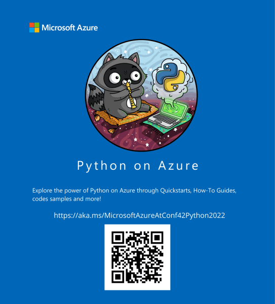

# Microsoft loves Conf42 Python!

Conf42 Blog, 2022-01-25. https://www.conf42.com/2022-01-25-microsoft-loves-conf42-python

In short: Join us online on January 27th, 2022!

### Join us online on January 27th, 2022!

[Conf42 Python](https://www.conf42.com/python2022) is something we look forward to every single year. The Node.js community is vibrant, diverse, and inclusive, and we love that we can help make Conf42 Python happen and bring the community together, in a unique, [online](https://www.conf42.com/python2022), way this year again.

[Python](https://www.python.org/) is widely used and supported by many different teams at [Microsoft](https://developer.microsoft.com/en-us/). Moreover, several of our customers rely on our tools and platforms for their Python codebases.

As an example, we have built out [support for Python in Visual Studio Code](https://aka.ms/MicrosoftAzureAtConf42Python2022) and [Python on Azure](https://aka.ms/MicrosoftAzureAtConf42Python2022).

We are invested in Python for the long term, and we want to help the Python community grow.

We are missing the opportunity to meet with Python developers in person this year, and we are putting all our energy into connecting virtually.

Meanwhile, we invite you to check the technical resources below:

- [Microsoft Azure @ Conf42 Python 2022](https://aka.ms/MicrosoftAzureAtConf42Python2022)
- [Azure Heroes @ Conf42 Python 2022 – Blockchain-based digital badges for developers (NFT Tokens)](https://aka.ms/AzureHeroesAtConf42Python2022)
- [Cloud Skills Challenge - Conf42 Python 2022 - Free course @ Microsoft LEARN! Learn all things about Python on Azure, free beginner to Ninja courses.](https://docs.microsoft.com/en-us/learn/challenges?id=cba210f7-ace3-4450-8f22-2df249457569)

_This blog was written on behalf of Microsoft by Juarez Junior, Azure Developer Relations Lead at Microsoft Ireland._

#### _Microsoft Ireland is a Gold sponsor of [Conf42 Python 2022](https://www.conf42.com/python2022)_
