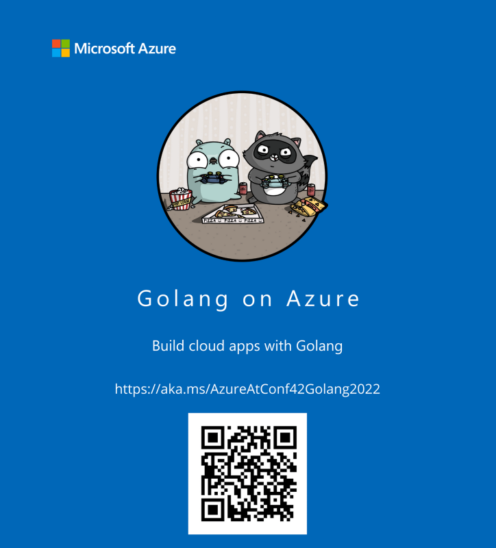
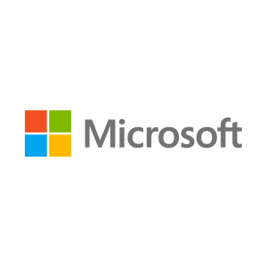

# Microsoft loves Conf42 Golang!

Conf42 Blog, 2022-03-24. https://www.conf42.com/2022-03-24-microsoft-golang-sponsor-announcement

In short: Join Microsoft and Conf42 online on March 31st, 2022!

# Join us online on March 31st, 2022!

[Conf42 Golang](https://www.conf42.com/golang2022) is something we look forward to every single year. The Go community is vibrant, diverse, and inclusive, and we love that we can help make Conf42 Golang happen and bring the community together, in a unique, [online](https://www.conf42.com/golang2022), way this year again.

[Golang](https://go.dev/) is widely supported by many different teams at [Microsoft](https://developer.microsoft.com/en-us/). Moreover, several of our customers rely on our tools and platforms for their Golang codebases.

As an example, we have built out [support for Golang in Visual Studio Code](https://code.visualstudio.com/docs/languages/go) and [Golang on Azure](https://docs.microsoft.com/en-us/azure/developer/go/).

#### We invite you to check the technical resources below:

- [Microsoft Azure @ Conf42 Golang 2022](https://aka.ms/AzureAtConf42Golang2022)
- [Azure Heroes @ Conf42 Golang 2022 – Blockchain-based digital badges for developers (NFT Tokens)](https://aka.ms/AzureHeroesAtConf42Golang)
- [Cloud Skills Challenge - Conf42 Golang 2022 - Free course @ Microsoft LEARN! Learn about Golang on Azure, free beginner courses.](https://aka.ms/MicrosoftAzureAtConf42Golang)

Enjoy [Conf42 Golang 2022](https://www.conf42.com/golang2022)!!!

_This blog was written on behalf of Microsoft by Juarez Junior, Azure Developer Relations Lead at Microsoft Ireland._

_Microsoft Ireland is a Gold sponsor of Conf42 Golang 2022._

