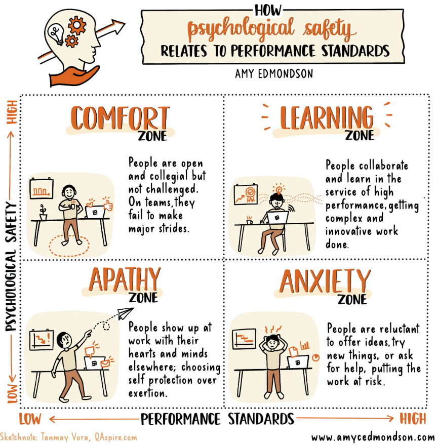

# Jeli.io <> Conf42 Incident Management 2022

Conf42 Blog, 2022-09-22. https://www.conf42.com/2022-09-22-jeli-im-sponsor-announcement

In short: Not Incidents. ‍Opportunities.

We've lived it just as you do: Incidents happen, despite the best plans and practices. They rarely go as imagined. Afterwards, a hapless engineer gets assigned to run a post-mortem meeting. The meeting isn't fully attended. The resulting report gets filed away where few will read it.

Our decades of combined experience in incident analysis at Jeli tell us that teams need mission-critical tools to adapt to continuously changing complex systems. That's why we give away a free IR Bot and offer a [free trial package](https://www.jeli.io/pricing) for small companies that includes our Narrative Builder, timelines, tags, investigator notes and multi-channel support. These are the very basics every company should have.

### We think big about the little things

Response teams are made of people, not machines and apps. We know, with cross discipline research backing us up, that people on distributed teams need an environment that supports them in ways that lead to better performance, more productivity, and much higher job satisfaction. These go together. We've baked that into our company culture and our product.

What creates that productive environment for learning and improving?

- **Make everyone feel safe sharing the truths:** Team members need _psychological safety_ — the certainty that they can do their jobs, speak necessary truths, and have potentially challenging conversations without repercussions. [Amy Edmondson](https://amycedmondson.com/) at Harvard Business School is a leading author on the topic with more than 20 years of research. Learning, she says, happens when high performance expectations and psychological safety are combined. She provides this helpful X/Y infographic that resonates with us.

_Infographic of how psychological safety and performance standards combine to create a Learning Zone. Source:_ [_Amy Edmondson_](https://amycedmondson.com/)_, Harvard Business School_

- **Share**** findings effectively:** Burying a retrospective report doesn't lead to improved performance, increased productivity, or a healthier work environment. Our [Conf42 keynote](https://www.conf42.com/Incident_Management_2022_Vanessa_Huerta_Granda_sharing_Incident_findings_effectively) by Jeli Solutions Engineer Vanessa Huerta Granda will get to the nuts and bolts of how to ensure that your learnings from incidents reach the most people and have the deepest impact. (For starters: craft a short abstract as your incident's elevator pitch. Use it to get those who didn't attend the retro to decide to learn more about the incident and get behind your proposed solutions.) Vanessa has a lot more to share — don't miss her talk!

- **Learn across incidents over time:** We call it cross-incident analysis, or XIA, in our work. Jeli's tools are designed and built knowing that incidents don't live independently of one another. They're best viewed as a connected series of events to be analyzed as a whole. Seeing incidents as part of a connected whole helps you avoid fixing one thing by breaking another, identify organizational contributing factors (code freezes!), and develop a long-term big picture of how best to deploy your organization's talent and budget — over time, a series of minor issues can wreak unseen havoc on costs.

### We want to learn with you

No one person or group has more than a fraction of the knowledge, experience and insights we share as a group, often without knowing it. We're always eager to connect and learn with others. Please join us for [Vanessa's keynote](https://www.conf42.com/Incident_Management_2022_Vanessa_Huerta_Granda_sharing_Incident_findings_effectively) and [get in touch](https://www.jeli.io/contact) to stay connected!

#### [Jeli.io](https://www.jeli.io) - Diamond Sponsor of [Conf42 Incident Management 2022](https://www.conf42.com/im2022)
